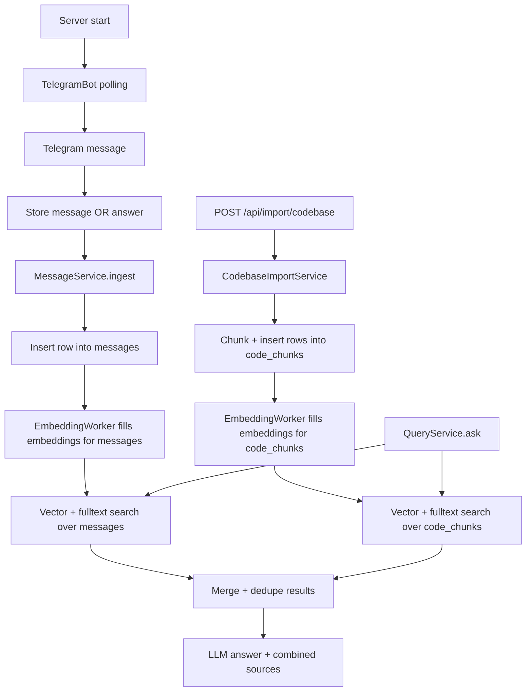

# Codebase Import + Dual-Table Retrieval Plan

This document describes how to add **codebase indexing** to OrgBrain without changing how conversation ingestion works today.

Key requirement: **code chunks are stored in a separate table** (`code_chunks`), and **every user query** (Telegram trigger or REST `/api/brain/ask`) searches **both**:

- conversation index: `messages`
- code index: `code_chunks`

The results are merged and provided to the LLM so answers can cite both conversation and code snippet sources.

---

## Current OrgBrain behavior (what we keep)

OrgBrain already does the following:

1. **Telegram ingestion (polling)**
   - `src/services/telegram.service.ts` listens for text messages.
   - Non-questions are stored via `MessageService.ingest(...)`.
   - Questions trigger `QueryService.ask(...)` and return an LLM answer with sources.

2. **Message storage + embeddings**
   - `src/services/message.service.ts` stores raw messages in Supabase (`messages` table).
   - It generates embeddings and stores them on the message row (`embedding` column).
   - `src/services/embedding.worker.ts` periodically finds rows with missing embeddings and fills them.

3. **Hybrid retrieval + answer generation**
   - `src/services/query.service.ts`:
     - embeds the question
     - performs parallel hybrid search:
       - vector search (pgvector cosine) using an RPC
       - full-text keyword search using a tsvector-based RPC
     - merges + (optionally) reranks
     - builds an LLM prompt using matched context messages
     - temperature: 0.3, maxTokens: 500

This behavior will remain unchanged for conversations in the `messages` table.

---

## Pre-existing bugs to fix BEFORE implementation

These bugs exist in the current codebase and **must** be fixed as prerequisites — they will break the new feature if left unresolved.

### Bug 1: Embedding dimension mismatch (CRITICAL)

**Problem**: The SQL migration (`001_initial_schema.sql`) defines `VECTOR(1536)` on the `messages.embedding` column and in the `search_messages()` RPC function signature. However, **all three AI providers** (OpenAI, Cohere, Zhipu) are configured to produce **1024-dimensional** embeddings in `app.constants.ts`.

**Evidence**:
- `001_initial_schema.sql:36` → `embedding VECTOR(1536)`
- `001_initial_schema.sql:91` → `query_embedding VECTOR(1536)` in function signature
- `app.constants.ts` → all providers: `embeddingDimensions: 1024`

**Impact**: If anyone has been using the system, either:
- Embeddings are being silently padded/truncated by pgvector (corrupting search quality), OR
- Vector inserts are failing entirely.

**Fix**:
1. In `002_code_chunks_schema.sql` (the new migration), include an `ALTER` to fix the existing schema:
   ```sql
   -- Fix existing messages table: change VECTOR(1536) → VECTOR(1024)
   -- NOTE: If messages.embedding already has data, you must drop and recreate the column
   -- or use ALTER TABLE messages ALTER COLUMN embedding TYPE vector(1024);
   ALTER TABLE messages ALTER COLUMN embedding TYPE vector(1024);

   -- Recreate the IVFFlat index (required after column type change)
   DROP INDEX IF EXISTS idx_messages_embedding;
   CREATE INDEX idx_messages_embedding
     ON messages USING ivfflat (embedding vector_cosine_ops) WITH (lists = 100);

   -- Recreate the search_messages function with corrected dimension
   CREATE OR REPLACE FUNCTION search_messages(
     query_embedding VECTOR(1024), ...
   ```
2. Update the stale backward-compat constants in `app.constants.ts`:
   ```ts
   // Remove or update these misleading values:
   export const EMBEDDING_DIMENSIONS = 1024; // was 1536
   ```

### Bug 2: Duplicate CREATE TABLE in migration

**Problem**: `001_initial_schema.sql` contains the `CREATE TABLE IF NOT EXISTS messages (...)` statement **twice** (lines 25-41 and lines 41-60), with the second one nested inside the first's closing.

**Impact**: The migration may error on Supabase depending on the parser. It's benign if `IF NOT EXISTS` suppresses it, but it's clearly a copy-paste artifact.

**Fix**: Remove the duplicate block. (Can be done in the same PR or separately.)

### Bug 3: Debug console.log statements in production code

**Problem**: `message.repository.ts:94` has `console.log("hitted ehre")` and line 103 has `console.log(data)`.

**Fix**: Remove both lines.

---

## Goal (what we add)

Add an API-driven workflow to:

1. **Import/index a codebase directory**
   - Input: server-local absolute directory path (`file_path`)
   - Server responsibilities:
     - recursively traverse files
     - chunk file contents
     - embed chunks and store them in a dedicated code index

2. **Answer questions using both sources**
   - At query time, search both:
     - `messages` (existing conversation index)
     - `code_chunks` (new code index)
   - Merge results and send combined context to the LLM
   - Return sources that may include both:
     - chat citations (who/when via Telegram)
     - code citations (file path + snippet)

---

## Data model design: `code_chunks` is separate

### Why a separate table?

- Avoid mixing chat messages and code chunks in one row type.
- Keep existing retrieval logic for conversations stable.
- Allow independent metadata fields suited to code (file path, chunk id, language).

### `code_chunks` table schema

```sql
CREATE TABLE IF NOT EXISTS code_chunks (
  id             TEXT PRIMARY KEY DEFAULT gen_random_uuid()::TEXT,
  workspace_id   TEXT NOT NULL REFERENCES workspaces(id),
  source_chunk_id TEXT NOT NULL,          -- deterministic hash for dedup (see below)
  file_path      TEXT NOT NULL,           -- relative path within repo, e.g. "src/foo.ts"
  repo_name      TEXT NOT NULL DEFAULT '',-- optional grouping label
  language       TEXT NOT NULL DEFAULT '',-- file extension or detected language
  chunk_index    INT NOT NULL DEFAULT 0,  -- ordering within a file (0, 1, 2, ...)
  content        TEXT NOT NULL,           -- prefixed with "File: <path>\n\n<chunk text>"
  embedding      VECTOR(1024),           -- matches provider dimensions exactly
  search_vector  TSVECTOR,               -- full-text search (auto-populated by trigger)
  created_at     TIMESTAMPTZ NOT NULL DEFAULT NOW(),

  -- Prevent duplicate chunks (same content from same file re-import)
  UNIQUE(workspace_id, source_chunk_id)
);
```

### `source_chunk_id` computation

To ensure re-imports don't duplicate rows:

```ts
import { createHash } from "crypto";

function computeChunkId(filePath: string, chunkIndex: number, content: string): string {
  return createHash("sha256")
    .update(`${filePath}::${chunkIndex}::${content}`)
    .digest("hex")
    .slice(0, 32); // 32 hex chars = 128 bits, sufficient for uniqueness
}
```

**Why include `content` in the hash**: If the file changes, old chunk hashes become stale, and the new content inserts as a new row. Old rows can be cleaned up later.

**Why include `chunkIndex`**: Two different chunks from the same file with overlapping content shouldn't collide.

---

## Pipeline overview (end-to-end)



---

## Codebase import: API + service responsibilities

### API endpoint

`POST /api/import/codebase`

Request body:

```json
{
  "file_path": "C:\\Users\\dev\\projects\\my-app",
  "workspace_id": "default",
  "repo_name": "my-app"
}
```

- `file_path` (string, required): local absolute directory path
- `workspace_id` (string, optional): defaults to `default`
- `repo_name` (string, optional): metadata for citations/grouping

Response: `202` with `{ job_id: string }`

### Validation schema (Zod)

New file: `src/lib/validations/codebase-import.schema.ts`

```ts
import { z } from "zod";

export const codebaseImportSchema = z.object({
  file_path: z.string().min(1, "file_path is required"),
  workspace_id: z.string().optional().default("default"),
  repo_name: z.string().optional().default(""),
});

export type CodebaseImportInput = z.infer<typeof codebaseImportSchema>;
```

### Job status

Same pattern as existing Telegram import:

- the server kicks off import work in the background
- it stores job status in-memory for V1
- `GET /api/import/status/:jobId` returns progress (reuse existing endpoint)

### `CodebaseImportService` steps

1. **Validate** the input directory exists (`fs.existsSync` + `fs.statSync.isDirectory()`)
2. **Recursively walk** the directory using `fs.readdirSync(dir, { withFileTypes: true, recursive: true })`
3. **Filter files** — include/exclude:
   - **Include extensions**: `ts, tsx, js, jsx, py, go, java, cs, rb, php, rs, c, cpp, h, hpp, md, yaml, yml, json, txt, toml, cfg, ini, sh, bash, sql, html, css, scss, svelte, vue`
   - **Exclude directories**: `node_modules, .git, dist, build, out, .next, coverage, venv, __pycache__, .venv, .tox, .mypy_cache, .pytest_cache, target, bin, obj, .idea, .vscode, vendor`
   - **Exclude files**: `package-lock.json, yarn.lock, pnpm-lock.yaml, *.min.js, *.min.css, *.map, *.bundle.js`
   - **Max file size**: skip files > 512 KB (avoids minified bundles, generated code, large data files)
4. **Read each file** as UTF-8, skip files that fail to read (binary, encoding issues)
5. **Chunk** each file's content:
   - defaults (V1):
     - `maxChars` = 3000 (not 4000 — leaves room for the file path prefix and avoids exceeding token limits when multiple chunks are combined as context)
     - `overlap` = 200 characters
   - prefix each chunk with `File: <relative_path>\n\n` so the LLM and citations know the source
6. **Batch insert** chunks into `code_chunks` (batch size: 50, matching existing IMPORT_BATCH_SIZE)
   - store `embedding = NULL` initially
   - use UPSERT on `(workspace_id, source_chunk_id)` to skip unchanged chunks on re-import
7. **Let `EmbeddingWorker` fill embeddings** asynchronously

### Chunking implementation

New file: `src/lib/utils/chunker.ts`

```ts
export interface ChunkResult {
  content: string;      // "File: path\n\n<chunk text>"
  chunkIndex: number;
  filePath: string;
}

export function chunkFileContent(
  filePath: string,
  rawContent: string,
  maxChars: number = 3000,
  overlap: number = 200,
): ChunkResult[] {
  const chunks: ChunkResult[] = [];
  const prefix = `File: ${filePath}\n\n`;
  const effectiveMax = maxChars - prefix.length;

  if (rawContent.length <= effectiveMax) {
    chunks.push({ content: prefix + rawContent, chunkIndex: 0, filePath });
    return chunks;
  }

  let start = 0;
  let index = 0;
  while (start < rawContent.length) {
    const end = Math.min(start + effectiveMax, rawContent.length);
    const slice = rawContent.slice(start, end);
    chunks.push({ content: prefix + slice, chunkIndex: index, filePath });
    start += effectiveMax - overlap;
    index++;
  }

  return chunks;
}
```

### File traversal implementation

New file: `src/lib/utils/file-walker.ts`

```ts
import * as fs from "fs";
import * as path from "path";

const INCLUDE_EXTENSIONS = new Set([
  "ts","tsx","js","jsx","py","go","java","cs","rb","php","rs",
  "c","cpp","h","hpp","md","yaml","yml","json","txt","toml",
  "cfg","ini","sh","bash","sql","html","css","scss","svelte","vue",
]);

const EXCLUDE_DIRS = new Set([
  "node_modules",".git","dist","build","out",".next","coverage",
  "venv","__pycache__",".venv",".tox",".mypy_cache",".pytest_cache",
  "target","bin","obj",".idea",".vscode","vendor",
]);

const EXCLUDE_FILES = new Set([
  "package-lock.json","yarn.lock","pnpm-lock.yaml",
]);

const MAX_FILE_SIZE_BYTES = 512 * 1024; // 512 KB

export interface WalkedFile {
  absolutePath: string;
  relativePath: string; // relative to root dir, always forward-slashed
  extension: string;
}

export function walkDirectory(rootDir: string): WalkedFile[] {
  const results: WalkedFile[] = [];

  function walk(dir: string) {
    const entries = fs.readdirSync(dir, { withFileTypes: true });
    for (const entry of entries) {
      const fullPath = path.join(dir, entry.name);

      if (entry.isDirectory()) {
        if (!EXCLUDE_DIRS.has(entry.name)) {
          walk(fullPath);
        }
        continue;
      }

      if (!entry.isFile()) continue;

      // Check excluded file names
      if (EXCLUDE_FILES.has(entry.name)) continue;

      // Check extension
      const ext = path.extname(entry.name).slice(1).toLowerCase();
      if (!INCLUDE_EXTENSIONS.has(ext)) continue;

      // Check file size
      try {
        const stat = fs.statSync(fullPath);
        if (stat.size > MAX_FILE_SIZE_BYTES) continue;
        if (stat.size === 0) continue;
      } catch {
        continue;
      }

      // Normalize path: always use forward slashes for consistent storage
      const relativePath = path.relative(rootDir, fullPath).replace(/\\/g, "/");

      results.push({ absolutePath: fullPath, relativePath, extension: ext });
    }
  }

  walk(rootDir);
  return results;
}
```

> **Windows note**: The project runs on Windows. `path.relative` produces backslash paths. We normalize to forward slashes before storing in `code_chunks.file_path` so citations look clean and are consistent across platforms.

---

## Embedding and search: keep it asynchronous

The plan extends the existing worker:

- `src/services/embedding.worker.ts`
  - currently fills `messages.embedding` when null
  - **must also fill `code_chunks.embedding` when null**

### Changes to EmbeddingWorker

The worker's `processBatch()` method needs a second step:

```ts
async processBatch(): Promise<number> {
  // 1. Process unembedded messages (existing)
  const messages = await MessageRepository.getUnembedded(EMBEDDING_WORKER_BATCH_SIZE);
  let embedded = 0;
  for (const msg of messages) { /* existing logic */ }

  // 2. Process unembedded code chunks (NEW)
  const chunks = await CodebaseRepository.getUnembedded(EMBEDDING_WORKER_BATCH_SIZE);
  for (const chunk of chunks) {
    try {
      const embedding = await AIService.createEmbedding(chunk.content);
      await CodebaseRepository.updateEmbedding(chunk.id, embedding);
      embedded++;
    } catch (error) {
      console.error(`Failed to embed code chunk ${chunk.id}:`, error);
    }
  }

  return embedded;
}
```

This preserves API responsiveness during large imports.

### Rate limit concern

Large codebases (1000+ files) can produce 3000+ chunks. At 50 chunks per 5-second cycle, embedding all chunks takes ~5 minutes. If the embedding provider has rate limits:

- **Cohere free tier**: 100 calls/minute → worker should add a small delay (e.g., 200ms between calls) or batch embed if the provider supports it.
- **Mitigation for V1**: The worker already processes sequentially and has try/catch per item. If rate-limited, individual failures are logged and retried on the next cycle.
- **Future**: Batch embedding endpoint (Cohere supports `embed` with arrays of up to 96 texts).

---

## New types needed

### `CodeChunk` type

New file: `src/lib/types/code.types.ts`

```ts
export interface StoredCodeChunk {
  id: string;
  workspace_id: string;
  source_chunk_id: string;
  file_path: string;
  repo_name: string;
  language: string;
  chunk_index: number;
  content: string;
  embedding: number[] | null;
  search_vector: string | null;
  created_at: Date;
}

export interface CreateCodeChunkInput {
  workspace_id: string;
  source_chunk_id: string;
  file_path: string;
  repo_name: string;
  language: string;
  chunk_index: number;
  content: string;
}
```

### Updated `SearchResult` — make it generic

The current `SearchResult` is coupled to `StoredMessage`:

```ts
// CURRENT (message-only):
export interface SearchResult {
  message: StoredMessage;
  similarity: number;
}
```

**Problem**: Code chunks don't have `user_name`, `chat_id`, etc. We need `SearchResult` to work for both.

**Solution**: Introduce a unified search result type:

```ts
// In src/lib/types/message.types.ts — add:

export type SearchResultItem =
  | { kind: "message"; data: StoredMessage }
  | { kind: "code"; data: StoredCodeChunk };

export interface UnifiedSearchResult {
  item: SearchResultItem;
  similarity: number;
}
```

**Migration strategy**: To avoid breaking existing code, keep the old `SearchResult` type for internal message-only operations (MessageRepository returns `SearchResult[]` as before). Introduce `UnifiedSearchResult` at the merge layer in `QueryService`.

### Updated `BrainAnswer` sources

```ts
export interface BrainAnswer {
  answer: string;
  sources: Array<{
    content: string;
    user_name: string;      // "codebase" for code chunks
    source: string;         // "telegram" | "code" | etc.
    timestamp: Date;        // created_at for code chunks
    similarity: number;
    file_path?: string;     // present for code chunks only
  }>;
}
```

> Adding `file_path` as optional means the Telegram formatter can check `if (source.file_path)` to render code citations differently.

---

## Query time: search both tables and merge results

### Where to change

`src/services/query.service.ts`

### Current flow

1. Embed the question
2. Run hybrid search against `messages` only
3. Merge + rerank
4. Generate answer

### New flow

1. Embed the question (same as today)
2. Run hybrid search **in parallel against both repositories**:
   ```ts
   const [msgCosine, msgFulltext, codeCosine, codeFulltext] = await Promise.all([
     MessageRepository.searchSimilar(queryEmbedding, workspaceId, fetchCount, threshold),
     MessageRepository.searchFullText(question, workspaceId, FULLTEXT_SEARCH_LIMIT),
     CodebaseRepository.searchSimilar(queryEmbedding, workspaceId, fetchCount, threshold),
     CodebaseRepository.searchFullText(question, workspaceId, FULLTEXT_SEARCH_LIMIT),
   ]);
   ```
3. Merge within each table (existing dedup logic), then combine:
   ```ts
   const msgMerged = this.mergeResults(msgCosine, msgFulltext);
   const codeMerged = this.mergeCodeResults(codeCosine, codeFulltext);
   const combined = [...msgMerged, ...codeMerged]; // both types in one list
   ```
4. Rerank the **combined** set (if provider supports it):
   - Extract `.content` from both message and code results
   - Rerank all together — the reranker doesn't care about source type
   - Map back to original items using indices
5. Generate answer with combined context

### Context window budget

**Problem**: Code chunks (~3000 chars each) are much larger than typical chat messages (~100-300 chars). If we return 12 reranked results and several are code chunks, the combined context could be 30,000+ characters (~7500 tokens), which is fine for most LLMs but could crowd out conversation context.

**Mitigation for V1**:
- Cap total context at ~15,000 characters
- Prioritize reranked order (most relevant first)
- Truncate the list when the budget is exceeded, not individual chunks

### Context formatting for code vs messages

The `AIService.generateAnswer()` method currently formats all results as:
```
[1] [date] "content" — user_name via source
```

For code chunks, this should look different:
```
[CODE 1] [file: src/foo.ts] "chunk content..."
```

**Implementation**: Check the `kind` field of `UnifiedSearchResult` to format differently.

### Output

`QueryService.ask(...)` returns a single:

- `answer`
- `sources[]`

Sources now include:

- conversation sources (existing behavior) — with `user_name`, `source: "telegram"`, etc.
- code chunk sources (new behavior) — with `user_name: "codebase"`, `source: "code"`, `file_path: "src/foo.ts"`

The Telegram bot formatter can check `if (source.file_path)` to render code citations differently from chat citations.

---

## SYSTEM_PROMPT update

The current prompt says: _"You answer based ONLY on the provided context messages from the team's conversations."_

This must be updated to mention code context:

```ts
export const SYSTEM_PROMPT = `You are OrgBrain — an AI assistant that answers questions about a company's internal knowledge.

You answer based ONLY on the provided context, which may include:
- Team conversation messages (from Telegram, Slack, etc.)
- Code snippets from the company's codebase

Messages are ordered chronologically (oldest first). Pay close attention to timestamps.
Code snippets include file paths — always cite the file when referencing code.

Rules:
1. Only use information from the provided context.
2. If the context doesn't contain enough information, say so honestly.
3. For conversation context: cite who said it, when, and on which platform.
4. For code context: cite the file path and describe what the code does.
5. Keep answers concise and direct.
6. If multiple sources contain relevant info, synthesize them into a clear answer.
7. Format the response clearly for a chat interface (no markdown tables).
8. When messages contradict each other on the same topic, ALWAYS trust the most recent message as the current state.
9. When code and conversation context overlap, prioritize the code as the source of truth for "what the code does" and conversation for "why it was done."`;
```

---

## Dedup/update strategy (for code chunks)

Since file imports can be repeated, V1 avoids duplicating identical chunks.

Plan:

- compute a deterministic `source_chunk_id` = `sha256(file_path + "::" + chunk_index + "::" + content)` truncated to 32 hex chars
- enforce uniqueness in the DB: `UNIQUE(workspace_id, source_chunk_id)`
- use UPSERT with `ignoreDuplicates: true` — unchanged content skips silently
- changed content produces a new hash → inserts as a new row

### Stale chunk cleanup

On re-import, old chunks from files that changed or were deleted become orphaned. V1 does **not** auto-delete them (safe default). Future options:

- Before import, mark all chunks for `repo_name` + `workspace_id` as "pending_delete"
- After import, delete chunks still marked "pending_delete"
- Or: add `import_batch_id` column and delete chunks from older batches

---

## SQL migration: `002_code_chunks_schema.sql`

Full migration file:

```sql
-- ============================================
-- OrgBrain V1.1 — Code Chunks Schema
-- Run this in Supabase SQL Editor AFTER 001
-- ============================================

-- ─── Fix existing dimension mismatch ────────
-- All providers output 1024-dim vectors, but 001 defined VECTOR(1536).
-- If messages.embedding has data, this ALTER will fail if dimensions don't match.
-- In that case, drop the column and recreate:
--   ALTER TABLE messages DROP COLUMN embedding;
--   ALTER TABLE messages ADD COLUMN embedding VECTOR(1024);
ALTER TABLE messages ALTER COLUMN embedding TYPE vector(1024);

-- Recreate vector search index with correct dimension
DROP INDEX IF EXISTS idx_messages_embedding;
CREATE INDEX idx_messages_embedding
  ON messages USING ivfflat (embedding vector_cosine_ops) WITH (lists = 100);

-- Recreate search_messages function with correct VECTOR(1024)
CREATE OR REPLACE FUNCTION search_messages(
  query_embedding VECTOR(1024),
  match_workspace_id TEXT,
  match_count INT DEFAULT 5,
  similarity_threshold FLOAT DEFAULT 0.3
)
RETURNS TABLE (
  id TEXT,
  workspace_id TEXT,
  source TEXT,
  source_message_id TEXT,
  user_name TEXT,
  user_id TEXT,
  chat_id TEXT,
  chat_name TEXT,
  content TEXT,
  "timestamp" TIMESTAMPTZ,
  created_at TIMESTAMPTZ,
  similarity FLOAT
)
LANGUAGE plpgsql
AS $$
BEGIN
  RETURN QUERY
  SELECT
    m.id, m.workspace_id, m.source, m.source_message_id,
    m.user_name, m.user_id, m.chat_id, m.chat_name,
    m.content, m."timestamp", m.created_at,
    1 - (m.embedding <=> query_embedding) AS similarity
  FROM messages m
  WHERE m.workspace_id = match_workspace_id
    AND m.embedding IS NOT NULL
    AND 1 - (m.embedding <=> query_embedding) > similarity_threshold
  ORDER BY m.embedding <=> query_embedding
  LIMIT match_count;
END;
$$;

-- ─── Code Chunks Table ──────────────────────
CREATE TABLE IF NOT EXISTS code_chunks (
  id              TEXT PRIMARY KEY DEFAULT gen_random_uuid()::TEXT,
  workspace_id    TEXT NOT NULL REFERENCES workspaces(id),
  source_chunk_id TEXT NOT NULL,
  file_path       TEXT NOT NULL,
  repo_name       TEXT NOT NULL DEFAULT '',
  language        TEXT NOT NULL DEFAULT '',
  chunk_index     INT NOT NULL DEFAULT 0,
  content         TEXT NOT NULL,
  embedding       VECTOR(1024),
  search_vector   TSVECTOR,
  created_at      TIMESTAMPTZ NOT NULL DEFAULT NOW(),

  UNIQUE(workspace_id, source_chunk_id)
);

-- ─── Code Chunks Indexes ────────────────────
CREATE INDEX IF NOT EXISTS idx_code_chunks_embedding
  ON code_chunks USING ivfflat (embedding vector_cosine_ops) WITH (lists = 100);

CREATE INDEX IF NOT EXISTS idx_code_chunks_search_vector
  ON code_chunks USING gin (search_vector);

CREATE INDEX IF NOT EXISTS idx_code_chunks_workspace
  ON code_chunks(workspace_id);

CREATE INDEX IF NOT EXISTS idx_code_chunks_file_path
  ON code_chunks(file_path);

CREATE INDEX IF NOT EXISTS idx_code_chunks_repo_name
  ON code_chunks(repo_name);

-- ─── Code Chunks Full-Text Trigger ──────────
CREATE OR REPLACE FUNCTION code_chunks_search_vector_trigger()
RETURNS trigger
LANGUAGE plpgsql
AS $$
BEGIN
  NEW.search_vector := to_tsvector('english', COALESCE(NEW.content, ''));
  RETURN NEW;
END;
$$;

DROP TRIGGER IF EXISTS trg_code_chunks_search_vector ON code_chunks;
CREATE TRIGGER trg_code_chunks_search_vector
  BEFORE INSERT OR UPDATE OF content ON code_chunks
  FOR EACH ROW
  EXECUTE FUNCTION code_chunks_search_vector_trigger();

-- ─── Code Chunks Vector Search ──────────────
CREATE OR REPLACE FUNCTION search_code_chunks(
  query_embedding VECTOR(1024),
  match_workspace_id TEXT,
  match_count INT DEFAULT 5,
  similarity_threshold FLOAT DEFAULT 0.3
)
RETURNS TABLE (
  id TEXT,
  workspace_id TEXT,
  source_chunk_id TEXT,
  file_path TEXT,
  repo_name TEXT,
  language TEXT,
  chunk_index INT,
  content TEXT,
  created_at TIMESTAMPTZ,
  similarity FLOAT
)
LANGUAGE plpgsql
AS $$
BEGIN
  RETURN QUERY
  SELECT
    c.id, c.workspace_id, c.source_chunk_id,
    c.file_path, c.repo_name, c.language, c.chunk_index,
    c.content, c.created_at,
    1 - (c.embedding <=> query_embedding) AS similarity
  FROM code_chunks c
  WHERE c.workspace_id = match_workspace_id
    AND c.embedding IS NOT NULL
    AND 1 - (c.embedding <=> query_embedding) > similarity_threshold
  ORDER BY c.embedding <=> query_embedding
  LIMIT match_count;
END;
$$;

-- ─── Code Chunks Full-Text Search ───────────
CREATE OR REPLACE FUNCTION search_code_chunks_fulltext(
  search_query TEXT,
  match_workspace_id TEXT,
  match_count INT DEFAULT 20
)
RETURNS TABLE (
  id TEXT,
  workspace_id TEXT,
  source_chunk_id TEXT,
  file_path TEXT,
  repo_name TEXT,
  language TEXT,
  chunk_index INT,
  content TEXT,
  created_at TIMESTAMPTZ,
  rank FLOAT
)
LANGUAGE plpgsql
AS $$
DECLARE
  tsquery_val TSQUERY;
BEGIN
  tsquery_val := plainto_tsquery('english', search_query);

  IF tsquery_val = ''::TSQUERY THEN
    RETURN;
  END IF;

  RETURN QUERY
  SELECT
    c.id, c.workspace_id, c.source_chunk_id,
    c.file_path, c.repo_name, c.language, c.chunk_index,
    c.content, c.created_at,
    ts_rank(c.search_vector, tsquery_val)::FLOAT AS rank
  FROM code_chunks c
  WHERE c.workspace_id = match_workspace_id
    AND c.search_vector @@ tsquery_val
  ORDER BY rank DESC
  LIMIT match_count;
END;
$$;
```

### IVFFlat index caveat

IVFFlat indexes work best with **>1000 rows** per list. With `lists = 100`, the index wants ~100,000+ rows. For small code imports (<1000 chunks), the index may actually hurt recall.

**Mitigation**: For V1, this is acceptable. If search quality is poor on small imports, switch to HNSW index (better for small datasets) or use exact search (`<=>` without index).

---

## New files to create

| File | Purpose |
|------|---------|
| `src/services/codebase-import.service.ts` | Directory traversal + chunking + batch insert |
| `src/db/codebase.repository.ts` | All DB operations for `code_chunks` |
| `src/db/migrations/002_code_chunks_schema.sql` | Schema + indexes + RPC functions |
| `src/lib/types/code.types.ts` | `StoredCodeChunk`, `CreateCodeChunkInput` |
| `src/lib/utils/chunker.ts` | Text chunking with overlap |
| `src/lib/utils/file-walker.ts` | Recursive directory walker with filters |
| `src/lib/validations/codebase-import.schema.ts` | Zod schema for import endpoint |

## Existing files to modify

| File | Changes |
|------|---------|
| `src/services/embedding.worker.ts` | Add code chunk embedding loop alongside messages |
| `src/services/query.service.ts` | Search both tables, merge, format combined context |
| `src/services/ai.service.ts` | Update `generateAnswer` to accept unified results, update context formatting |
| `src/routes/import.route.ts` | Add `POST /api/import/codebase` endpoint |
| `src/lib/types/message.types.ts` | Add `UnifiedSearchResult`, update `BrainAnswer` sources |
| `src/lib/types/index.ts` | Re-export new code types |
| `src/lib/constants/app.constants.ts` | Update `SYSTEM_PROMPT`, fix `EMBEDDING_DIMENSIONS`, add codebase constants |
| `src/lib/constants/import.constants.ts` | Add `CODEBASE_CHUNK_MAX_CHARS`, `CODEBASE_CHUNK_OVERLAP`, `MAX_FILE_SIZE_BYTES` |
| `src/db/message.repository.ts` | Remove debug console.log statements |

---

## Implementation order (recommended)

### Phase 1: Fix pre-existing bugs
1. Fix `001_initial_schema.sql` duplicate CREATE TABLE
2. Remove debug `console.log` from `message.repository.ts`
3. Fix `EMBEDDING_DIMENSIONS` constant in `app.constants.ts`
4. Run migration 002 which fixes VECTOR dimension on existing `messages` table

### Phase 2: Data layer
5. Create `src/lib/types/code.types.ts`
6. Update `src/lib/types/message.types.ts` (add `UnifiedSearchResult`, update `BrainAnswer`)
7. Update `src/lib/types/index.ts` to re-export
8. Create `src/db/migrations/002_code_chunks_schema.sql`
9. Create `src/db/codebase.repository.ts`

### Phase 3: Import pipeline
10. Create `src/lib/utils/file-walker.ts`
11. Create `src/lib/utils/chunker.ts`
12. Create `src/lib/validations/codebase-import.schema.ts`
13. Create `src/services/codebase-import.service.ts`
14. Update `src/routes/import.route.ts` (add codebase endpoint)
15. Add constants to `import.constants.ts`

### Phase 4: Embedding
16. Update `src/services/embedding.worker.ts` to process `code_chunks`

### Phase 5: Query pipeline
17. Update `src/services/query.service.ts` (dual-table search + merge)
18. Update `src/services/ai.service.ts` (unified context formatting)
19. Update `src/lib/constants/app.constants.ts` (`SYSTEM_PROMPT`)

### Phase 6: Verification
20. Manual end-to-end test (see acceptance test checklist)

---

## `CodebaseRepository` — full API surface

```ts
// src/db/codebase.repository.ts

export const CodebaseRepository = {
  // Insert a batch of code chunks (UPSERT, skip duplicates)
  async createBatch(inputs: CreateCodeChunkInput[]): Promise<number>;

  // Get chunks without embeddings (for worker)
  async getUnembedded(limit: number): Promise<StoredCodeChunk[]>;

  // Update embedding for a single chunk
  async updateEmbedding(chunkId: string, embedding: number[]): Promise<void>;

  // Vector similarity search via RPC
  async searchSimilar(
    queryEmbedding: number[], workspaceId: string,
    limit: number, threshold: number,
  ): Promise<{ chunk: StoredCodeChunk; similarity: number }[]>;

  // Full-text keyword search via RPC
  async searchFullText(
    query: string, workspaceId: string, limit: number,
  ): Promise<{ chunk: StoredCodeChunk; similarity: number }[]>;

  // Count chunks for a workspace (for health endpoint)
  async count(workspaceId: string): Promise<number>;
};
```

---

## Potential issues and mitigations

### Issue 1: Windows paths in `file_path` column
**Risk**: On Windows, `path.relative()` returns `src\foo\bar.ts`. If stored as-is, full-text search on `/` won't match, and citations look ugly.
**Fix**: Normalize all paths to forward slashes before storage (done in `file-walker.ts`).

### Issue 2: Encoding/binary files
**Risk**: Reading a binary file (image, compiled output) as UTF-8 produces garbage that wastes embedding tokens and pollutes search.
**Fix**: `file-walker.ts` only includes known text extensions. Additionally, wrap `fs.readFileSync(path, 'utf-8')` in try/catch — if it throws, skip the file.

### Issue 3: Very large repositories
**Risk**: A monorepo with 50,000+ files could produce 100,000+ chunks. The import would run for hours.
**Fix for V1**: The 512 KB file size limit and directory exclusions cut this significantly. The background worker processes at its own pace. The import endpoint returns immediately with a job ID. Acceptable for V1.

### Issue 4: Supabase row-level security (RLS)
**Risk**: If RLS is enabled on the `code_chunks` table, the service role key bypasses it, but queries via the anon key won't see rows.
**Fix**: The codebase uses `SUPABASE_SERVICE_ROLE_KEY` (visible in `env.ts`), which bypasses RLS. Ensure the Supabase client uses the service role key for all operations.

### Issue 5: IVFFlat index on small datasets
**Risk**: With <1000 code chunks and `lists = 100`, the IVFFlat index may have empty lists, causing missed results.
**Fix for V1**: Acceptable. If search quality is poor, switch to HNSW or exact brute-force search. Can be changed later without code changes (just SQL).

### Issue 6: Score normalization across tables
**Risk**: Cosine similarity scores from `messages` and `code_chunks` may not be directly comparable (different content distributions).
**Fix**: The reranker (Cohere) normalizes scores across all documents regardless of source table. Without reranking, results are already sorted by relevance within each source — the merge interleaves them, and the top-N cut is acceptable for V1.

### Issue 7: Overlapping context in LLM prompt
**Risk**: If both a chat message and a code chunk refer to the same thing, the LLM gets redundant context.
**Fix**: The reranker naturally deduplicates by relevance. For V1, minor redundancy is acceptable and may actually help the LLM see the connection between code and conversation.

### Issue 8: `MessageSource` type is a string union that doesn't include "code"
**Risk**: `BrainAnswer.sources[].source` is typed as `MessageSource = "telegram" | "slack" | ...`. Code chunks need `"code"`.
**Fix**: Either add `"code"` to `MESSAGE_SOURCES` array, or change `BrainAnswer.sources[].source` to `string`. Recommended: add `"code"` to the union.

### Issue 9: Embedding worker processes both tables every cycle
**Risk**: If there are 5000 unembedded messages AND 5000 unembedded chunks, the worker will try to do both in each cycle, potentially hitting rate limits harder.
**Fix**: Process messages first, then code chunks. The batch size limit (50) applies to each independently. In the worst case, we process 100 embeddings per cycle (50 messages + 50 chunks) every 5 seconds = 1200/min. Cohere free tier allows ~100/min, so the worker will hit rate limits and log errors but recover on next cycle. For V1, acceptable. For production: add inter-request delay or use batch embedding API.

### Issue 10: No way to delete indexed code
**Risk**: Once indexed, there's no API to remove a repo's chunks.
**Fix for V1**: Not blocking. Can be added as `DELETE /api/import/codebase/:repoName` later. For now, chunks can be deleted via Supabase dashboard.

---

## Acceptance test checklist

1. Start the server.
2. Run migration `002_code_chunks_schema.sql` in Supabase SQL editor.
3. Import a small code directory with `POST /api/import/codebase`:
   ```json
   {
     "file_path": "C:\\Users\\adars\\Documents\\GitHub\\The-brain\\src",
     "workspace_id": "default",
     "repo_name": "orgbrain"
   }
   ```
4. Check import status with `GET /api/import/status/:jobId` — wait for `"completed"`.
5. Wait for the embedding worker to process code chunks (watch server logs for "Embedded X/Y code chunks").
6. Ask a question via `POST /api/brain/ask`:
   ```json
   { "question": "How does the embedding worker process messages?", "workspace_id": "default" }
   ```
7. Verify:
   - the returned answer references code from `embedding.worker.ts`
   - sources include entries with `file_path` set (code sources)
   - if chat history is also relevant, those sources appear too
8. Ask via Telegram (if bot is running): `@orgbrain how does the query pipeline work?`
9. Verify Telegram response includes code citations formatted differently from chat citations.

---

## Notes / limitations for V1

1. **Job status is in-memory** (like current Telegram import). After restart, job history is lost.
2. **Codebase traversal uses a static include/exclude list**; customization can be added later.
3. **The query pipeline is extended, not replaced** — it adds a second retrieval source alongside the existing one.
4. **No incremental update** — re-importing the same repo re-inserts changed chunks and leaves old ones orphaned. Cleanup is manual for V1.
5. **No auth on the import endpoint** — V1 assumes the API is not publicly exposed. Add auth middleware before production.
6. **Full-text search uses English tsvector config** — code identifiers (camelCase, snake_case) may not tokenize well. For V1, the vector search is the primary retrieval path; full-text is supplementary.
7. **`maxTokens: 500`** on the LLM response may be too short for code-heavy answers. Consider increasing to 800-1000 when code sources are present.
