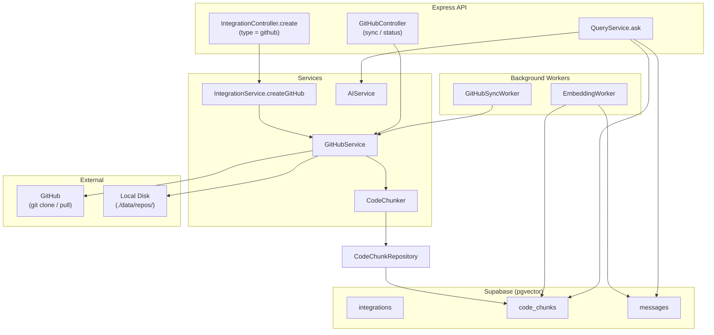
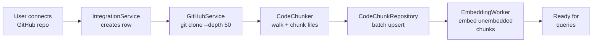
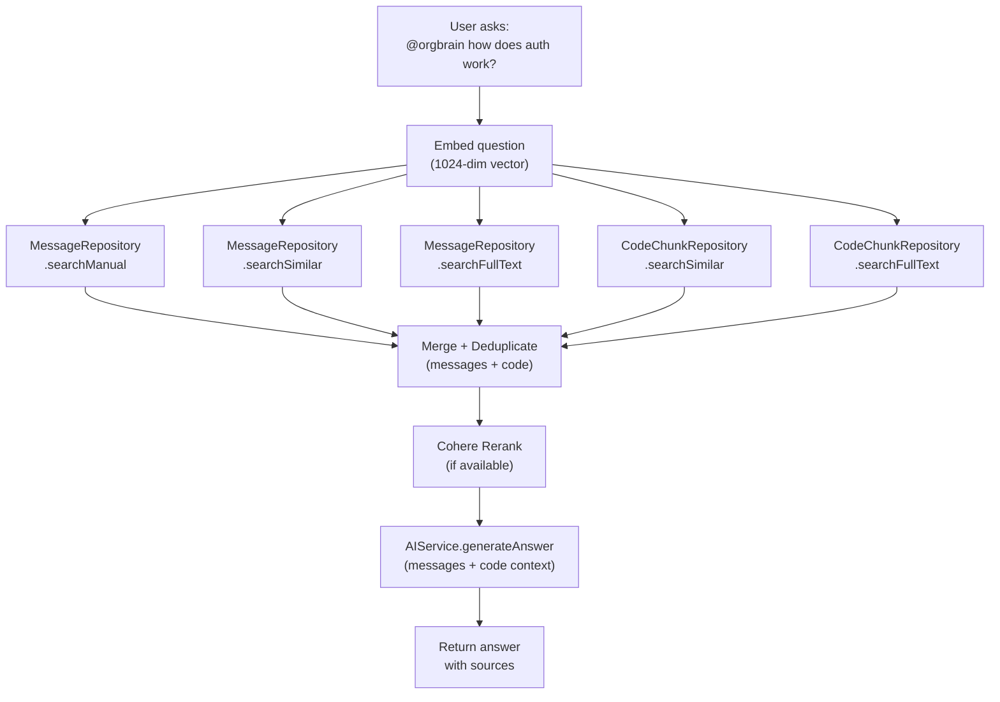
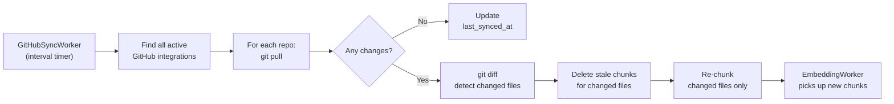

# GitHub Codebase Indexing — Backend Architecture

## Overview

OrgBrain can index a user's GitHub repository so that queries via Telegram (or the dashboard API) return answers informed by both team conversations **and** the project's codebase. This document describes the backend architecture powering this feature.

---

## System Architecture



---

## Database Schema

### `code_chunks` Table

| Column | Type | Description |
|--------|------|-------------|
| `id` | TEXT (UUID) | Primary key |
| `workspace_id` | TEXT | FK to `workspaces.id` |
| `integration_id` | TEXT | FK to `integrations.id` |
| `file_path` | TEXT | Relative path within the repo |
| `repo_name` | TEXT | e.g. `org/repo-name` |
| `language` | TEXT | Detected language (nullable) |
| `chunk_type` | TEXT | `file` or `segment` |
| `line_start` | INTEGER | Starting line number |
| `line_end` | INTEGER | Ending line number |
| `content` | TEXT | The code text (with file path header) |
| `embedding` | VECTOR(1024) | Embedding vector |
| `search_vector` | TSVECTOR | Auto-generated for full-text search |
| `created_at` | TIMESTAMPTZ | Row creation time |
| `updated_at` | TIMESTAMPTZ | Last update time |

**Unique constraint:** `(integration_id, file_path, line_start)` — prevents duplicate chunks.

### Indexes

- `idx_code_chunks_workspace` — workspace scoping
- `idx_code_chunks_integration` — per-repo queries
- `idx_code_chunks_embedding` — IVFFlat cosine similarity
- `idx_code_chunks_search_vector` — GIN full-text

### Search RPCs

- **`search_code_chunks`** — cosine similarity search (same signature pattern as `search_messages`)
- **`search_code_chunks_fulltext`** — PostgreSQL full-text search (same pattern as `search_messages_fulltext`)

Both accept `workspace_id` and optional `integration_id` for scoping.

---

## Indexing Pipeline



### Chunking Strategy

1. **Walk the repo** — recursively list all files, skip directories in the skip list (`.git`, `node_modules`, `dist`, `build`, `__pycache__`, etc.)
2. **Skip binary/irrelevant files** — lock files, images, fonts, archives, dotfiles
3. **Detect language** — from file extension (40+ languages mapped)
4. **Chunk by size:**
   - Files under ~4000 characters → single chunk with `// File: path/to/file` header
   - Larger files → split into ~2000-char windows with 200-char overlap at line boundaries
5. **Batch insert** — 100 chunks per batch via Supabase upsert

### Skip Lists

**Directories:** `.git`, `node_modules`, `dist`, `build`, `.next`, `__pycache__`, `.venv`, `vendor`, `.idea`, `.vscode`, `coverage`, `.cache`

**Files:** `package-lock.json`, `yarn.lock`, `pnpm-lock.yaml`, `bun.lockb`, `Cargo.lock`, binary extensions, images, fonts

---

## Query Pipeline



All 5 searches run in parallel. Message and code results are unified into a single ranked list, reranked together, and passed to the LLM. The system prompt instructs the AI to cite file paths for code sources and distinguish code from conversation context.

---

## Sync Pipeline



- **Interval:** configurable via `GITHUB_SYNC_INTERVAL_MS` (default 1 hour)
- **Incremental:** only changed files are re-indexed (detected via `git diff`)
- **Manual trigger:** `POST /api/v1/github/sync/:integrationId`

---

## API Endpoints

| Method | Path | Description |
|--------|------|-------------|
| POST | `/api/v1/workspaces/:id/integrations` | Create GitHub integration (`type: github`) |
| POST | `/api/v1/github/sync/:integrationId` | Trigger manual re-sync |
| GET | `/api/v1/github/status/:integrationId` | Get sync status + chunk count |
| DELETE | `/api/v1/workspaces/:id/integrations/:id` | Disconnect (cleans up repo + chunks) |

---

## Configuration

| Env Variable | Default | Description |
|--------------|---------|-------------|
| `GITHUB_REPOS_DIR` | `./data/repos` | Local directory for cloned repos |
| `GITHUB_SYNC_INTERVAL_MS` | `3600000` (1h) | Background sync interval |

### Integration Config (JSONB)

Stored in `integrations.config`:

```json
{
  "repo_url": "https://github.com/org/repo",
  "branch": "main",
  "access_token_ciphertext": "...",
  "access_token_iv": "...",
  "access_token_tag": "...",
  "last_synced_at": "2026-04-23T...",
  "chunk_count": 423
}
```

Access tokens are encrypted with AES-256-GCM using the same `INTEGRATION_ENCRYPTION_KEY` as Telegram bot tokens.

---

## New Files

| File | Purpose |
|------|---------|
| `src/db/migrations/005_code_chunks.sql` | Migration: table, indexes, RPCs |
| `src/db/code-chunk.repository.ts` | Data access for code_chunks |
| `src/lib/types/code-chunk.types.ts` | TypeScript types |
| `src/services/code-chunker.ts` | File walking + chunking logic |
| `src/services/github.service.ts` | Clone, index, sync operations |
| `src/services/github-sync.worker.ts` | Background sync worker |
| `src/controllers/github.controller.ts` | HTTP handlers for sync/status |
| `src/routes/github.route.ts` | Route definitions |

## Modified Files

| File | Change |
|------|--------|
| `src/config/env.ts` | Added `GITHUB_REPOS_DIR`, `GITHUB_SYNC_INTERVAL_MS` |
| `src/services/query.service.ts` | 5-way parallel search (messages + code) |
| `src/services/ai.service.ts` | Accepts code context in `generateAnswer` |
| `src/services/embedding.worker.ts` | Embeds code_chunks alongside messages |
| `src/services/integration.service.ts` | `createGitHub`, `getDecryptedGitHubToken`, cleanup on disconnect |
| `src/services/telegram.service.ts` | Code-aware source formatting |
| `src/controllers/integration.controller.ts` | Dispatches on integration type |
| `src/lib/validations/integration.schema.ts` | Discriminated union schema |
| `src/lib/constants/app.constants.ts` | Updated system prompt, added `CODE_SEARCH_RESULTS` |
| `src/lib/types/message.types.ts` | `BrainAnswerSource` with code fields |
| `src/lib/types/integration.types.ts` | `IntegrationResponse` with GitHub fields |
| `src/routes/main.route.ts` | Mounted `/github` router |
| `src/server.ts` | Starts `GitHubSyncWorker` |
