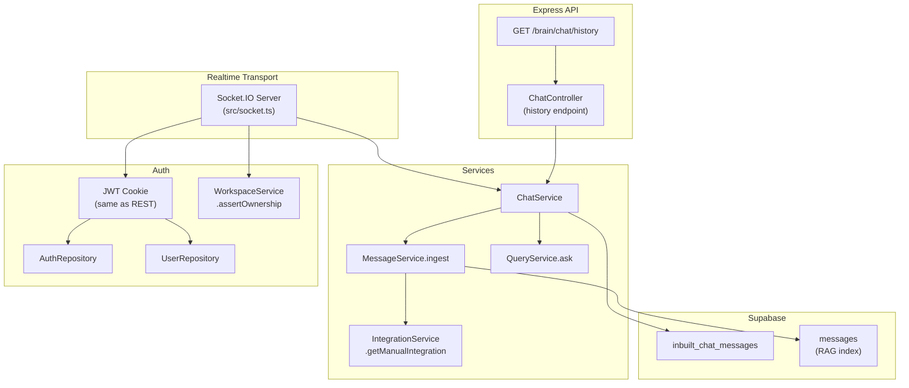
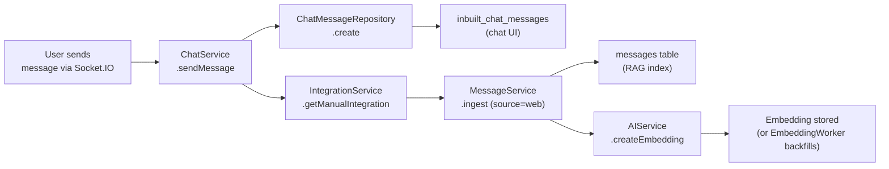
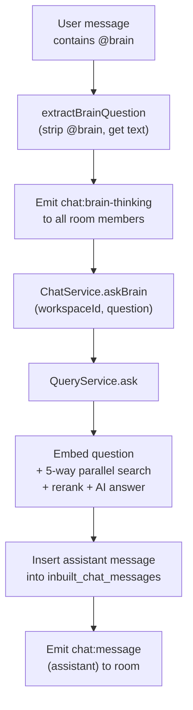

# Realtime Group Chat — Backend Architecture

## Overview

OrgBrain includes a built-in realtime group chat powered by Socket.IO. Each workspace has a shared chat thread where all members can message each other and query the brain via `@brain`. Every user message is dual-written: once to the `inbuilt_chat_messages` table (for the chat UI) and once through `MessageService.ingest()` (for the RAG knowledge base, with `source: "web"`). The AI responds using the same `QueryService.ask()` pipeline used by Telegram and the `/brain/ask` API.

---

## System Architecture



---

## Database Schema

### `inbuilt_chat_messages` Table

| Column | Type | Description |
|--------|------|-------------|
| `id` | TEXT (UUID) | Primary key, `gen_random_uuid()` |
| `workspace_id` | TEXT | FK to `workspaces.id`, CASCADE delete |
| `user_id` | TEXT | User ID (NULL for assistant messages) |
| `user_name` | TEXT | Display name (NULL for assistant) |
| `role` | TEXT | `user` or `assistant` (CHECK constraint) |
| `content` | TEXT | Message text |
| `sources` | JSONB | `BrainAnswerSource[]` for assistant messages, NULL otherwise |
| `created_at` | TIMESTAMPTZ | `NOW()` default |

**Index:** `(workspace_id, created_at DESC)` for efficient cursor-paginated queries.

**Migration:** `src/db/migrations/006_inbuilt_chat_messages.sql`

This table is separate from the `messages` table. The `messages` table stores RAG-indexed content (with embeddings) used by the query pipeline. The `inbuilt_chat_messages` table stores the chat thread for the UI. User messages are written to both.

---

## Message Lifecycle



Every user message follows two paths:
1. **Chat thread** — inserted into `inbuilt_chat_messages` for the group chat UI
2. **RAG knowledge base** — ingested via `MessageService.ingest()` with `source: "web"`, which stores it in the `messages` table and generates a vector embedding. This makes the message searchable by the AI in future queries.

The RAG ingestion mirrors exactly how Telegram messages are stored. The `source_message_id` is prefixed with `webchat:` to distinguish web chat messages from other sources.

---

## @brain Query Flow



The `@brain` trigger is a case-insensitive regex (`/\b@brain\b/i`). The question is extracted by stripping the `@brain` token. The query runs through the full existing pipeline: embedding, hybrid search (messages + code chunks), optional reranking, and LLM answer generation. No changes were made to `QueryService`, `AIService`, or any AI provider.

---

## Socket.IO Server (`src/socket.ts`)

### Initialization

Socket.IO is attached to the Express HTTP server. The `server.ts` entry point was changed from `app.listen()` to `http.createServer(app)` so both Express and Socket.IO share the same HTTP server and port.

```
http.createServer(app) → initSocketIO(httpServer) → httpServer.listen(PORT)
```

### Authentication Middleware

Socket.IO connections are authenticated using the same JWT cookie as REST requests:

1. Parse the `cookie` header from `socket.handshake.headers`
2. Extract the `token` cookie (same `COOKIE_NAME` as REST auth)
3. Verify with `jwt.verify(token, JWT_SECRET)`
4. Validate account status via `AuthRepository` (is_valid, password_changed_at)
5. Load user via `UserRepository`
6. Attach user to `socket.data.user`

Unauthenticated connections are rejected with `"Authentication required"`.

### Room Management

Each workspace has a Socket.IO room named `workspace:{workspaceId}`. When a client emits `chat:join`, the server:
1. Verifies the user has access via `WorkspaceService.assertOwnership()`
2. Joins the socket to the room
3. Returns `{ ok: true }` via callback

A socket must join a room before it can send messages or load history for that workspace.

### Event Handlers

| Event | Handler |
|-------|---------|
| `chat:join` | Verify workspace access, join room, acknowledge via callback |
| `chat:send` | Call `ChatService.sendMessage()`, broadcast `chat:message` to room. If content matches `@brain`, emit `chat:brain-thinking`, then `await ChatService.askBrain()`, then broadcast assistant `chat:message` |
| `chat:typing` | Broadcast `chat:user-typing` to other room members (sender excluded) |
| `chat:history` | Call `ChatService.getHistory()`, return via callback |

### CORS

Socket.IO CORS is configured to match the Express CORS origin (`env.CLIENT_ORIGIN`) with `credentials: true`.

---

## Services

### ChatService (`src/services/chat.service.ts`)

| Method | Description |
|--------|-------------|
| `sendMessage(workspaceId, userId, userName, content)` | Insert user message into `inbuilt_chat_messages`, then ingest into RAG via `MessageService.ingest()` with `source: "web"` |
| `askBrain(workspaceId, question)` | Call `QueryService.ask()`, insert assistant message with answer and sources |
| `getHistory(workspaceId, cursor?, limit?)` | Cursor-paginated history (delegates to repository) |

### ChatMessageRepository (`src/db/chat-message.repository.ts`)

| Method | Description |
|--------|-------------|
| `create(input)` | Insert into `inbuilt_chat_messages`, return the saved row |
| `listByWorkspace(workspaceId, { limit, before })` | Cursor-based pagination using `created_at`. Fetches `limit + 1` rows to determine `hasMore`. Returns messages in chronological order (oldest first) |

---

## REST API

| Method | Path | Auth | Description |
|--------|------|------|-------------|
| GET | `/api/v1/brain/chat/history` | `authenticate` + `requireWorkspaceAccess` | Paginated chat history |

**Query parameters:**

| Param | Type | Required | Description |
|-------|------|----------|-------------|
| `workspace_id` | string | Yes | Workspace to fetch history for |
| `before` | string (ISO date) | No | Cursor for pagination (fetch messages before this timestamp) |
| `limit` | number | No | Max messages to return (default 50) |

**Response:**

```json
{
  "status": 200,
  "data": {
    "messages": [
      {
        "id": "uuid",
        "workspace_id": "uuid",
        "user_id": "uuid | null",
        "user_name": "Alice | null",
        "role": "user | assistant",
        "content": "message text",
        "sources": null,
        "created_at": "2026-04-23T..."
      }
    ],
    "hasMore": true
  },
  "message": "Chat history retrieved"
}
```

This endpoint is used by the frontend for initial page load (fast first paint before the Socket.IO connection is established).

---

## Socket.IO Event Reference

| Event | Direction | Payload | Purpose |
|-------|-----------|---------|---------|
| `chat:join` | Client -> Server | `{workspaceId}` + callback | Join workspace room |
| `chat:send` | Client -> Server | `{content, workspaceId}` | Send a message |
| `chat:typing` | Client -> Server | `{workspaceId}` | Typing indicator |
| `chat:message` | Server -> Room | `ChatMessage` object | New message broadcast |
| `chat:brain-thinking` | Server -> Room | `{workspaceId}` | Brain is processing |
| `chat:brain-error` | Server -> Room | `{workspaceId, error}` | Brain query failed |
| `chat:user-typing` | Server -> Room (excl. sender) | `{userId, userName}` | Someone is typing |

---

## Message Source: `"web"`

The `MessageSource` union type in `src/lib/types/message.types.ts` was extended with `"web"`:

```typescript
export const MESSAGE_SOURCES = [
  "telegram", "slack", "github", "linear", "manual", "web",
] as const;
```

This allows `QueryService` to distinguish web chat messages from other sources in search results and source citations.

---

## New Files

| File | Purpose |
|------|---------|
| `src/db/migrations/006_inbuilt_chat_messages.sql` | Migration: table + index |
| `src/db/chat-message.repository.ts` | Data access for `inbuilt_chat_messages` |
| `src/services/chat.service.ts` | Chat business logic |
| `src/socket.ts` | Socket.IO server with auth + event handlers |
| `src/controllers/chat.controller.ts` | REST controller for chat history |
| `src/routes/chat.route.ts` | Route definitions |
| `docs/realtime-group-chat.md` | This documentation |

## Modified Files

| File | Change |
|------|--------|
| `src/server.ts` | Refactored to `http.createServer(app)`, added `initSocketIO()` |
| `src/lib/types/message.types.ts` | Added `"web"` to `MESSAGE_SOURCES`, added `ChatMessage` and `CreateChatMessageInput` types |
| `src/lib/types/index.ts` | Exported new types |
| `src/routes/main.route.ts` | Mounted `/brain/chat` router |
| `package.json` | Added `socket.io` dependency |
