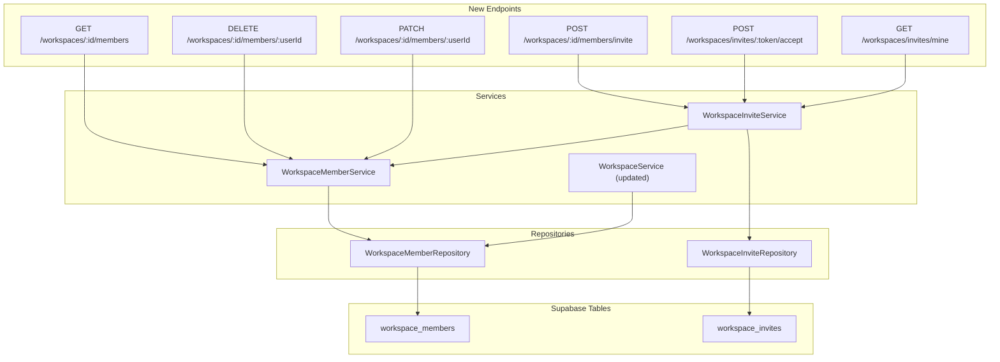
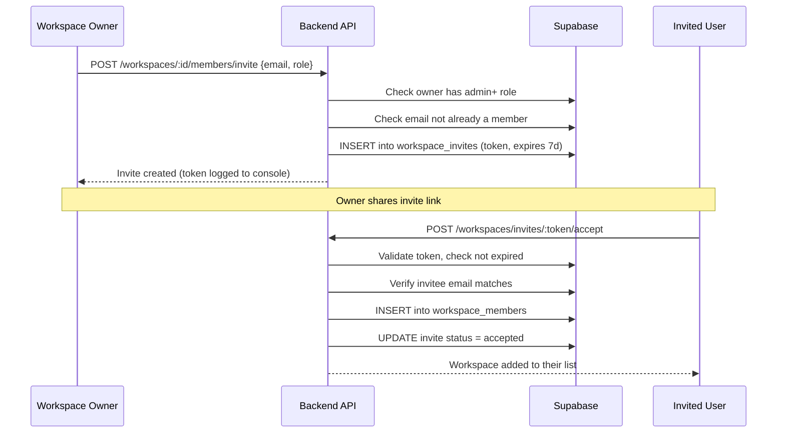

# Workspace Membership — Backend Implementation Plan

## Problem

Workspaces are currently **single-owner only**. The `workspaces` table has a `user_id` column that points to the sole owner, and `WorkspaceService.assertOwnership()` does a strict equality check (`workspace.user_id !== userId`). There is no `workspace_members` table, no invite system, and no role-based access. This means the group chat feature can only be used by the workspace creator talking to themselves.

## Current State

| Area | Current Behavior |
|------|------------------|
| `workspaces` table | Has `user_id` column (single owner FK to `users`) |
| `WorkspaceService.assertOwnership()` | `workspace.user_id !== userId` -> 403 |
| `WorkspaceService.listForUser()` | `WorkspaceRepository.findByOwner(userId)` -- only owned workspaces |
| `requireWorkspaceAccess` middleware | Calls `assertOwnership` -- owner-only |
| `socket.ts` (chat) | Calls `assertOwnership` on `chat:join` -- owner-only |
| Invites / email | No infrastructure; auth OTP is console-logged |

**Files that check workspace access (all must be updated):**
- `src/lib/middleware/require-workspace-access.ts` -- REST middleware
- `src/services/workspace.service.ts` -- `assertOwnership` and `ensureOwner`
- `src/services/integration.service.ts` -- double-checks ownership in `listForWorkspace`, `getById`, `createTelegram`, `createGitHub`
- `src/socket.ts` -- checks ownership on `chat:join`
- `src/controllers/workspace.controller.ts` -- uses `assertOwnership` for get/update/delete

---

## Goal

Allow multiple users to be members of a workspace with role-based permissions. The workspace creator remains the `owner`. Other users can be invited as `admin` or `member`.

---

## Database Schema

### New Table: `workspace_members`

```sql
CREATE TABLE IF NOT EXISTS workspace_members (
  id TEXT PRIMARY KEY DEFAULT gen_random_uuid()::TEXT,
  workspace_id TEXT NOT NULL REFERENCES workspaces(id) ON DELETE CASCADE,
  user_id TEXT NOT NULL REFERENCES users(id) ON DELETE CASCADE,
  role TEXT NOT NULL DEFAULT 'member' CHECK (role IN ('owner', 'admin', 'member')),
  invited_by TEXT REFERENCES users(id),
  created_at TIMESTAMPTZ NOT NULL DEFAULT NOW(),
  updated_at TIMESTAMPTZ NOT NULL DEFAULT NOW(),
  UNIQUE(workspace_id, user_id)
);

CREATE INDEX IF NOT EXISTS idx_workspace_members_workspace
  ON workspace_members(workspace_id);
CREATE INDEX IF NOT EXISTS idx_workspace_members_user
  ON workspace_members(user_id);
```

### New Table: `workspace_invites`

```sql
CREATE TABLE IF NOT EXISTS workspace_invites (
  id TEXT PRIMARY KEY DEFAULT gen_random_uuid()::TEXT,
  workspace_id TEXT NOT NULL REFERENCES workspaces(id) ON DELETE CASCADE,
  email TEXT NOT NULL,
  role TEXT NOT NULL DEFAULT 'member' CHECK (role IN ('admin', 'member')),
  invited_by TEXT NOT NULL REFERENCES users(id),
  status TEXT NOT NULL DEFAULT 'pending' CHECK (status IN ('pending', 'accepted', 'declined', 'expired')),
  token TEXT UNIQUE NOT NULL,
  expires_at TIMESTAMPTZ NOT NULL,
  created_at TIMESTAMPTZ NOT NULL DEFAULT NOW(),
  UNIQUE(workspace_id, email, status)
);

CREATE INDEX IF NOT EXISTS idx_workspace_invites_email
  ON workspace_invites(email);
CREATE INDEX IF NOT EXISTS idx_workspace_invites_token
  ON workspace_invites(token);
```

### Migration: `007_workspace_members.sql`

In addition to creating the tables above, the migration must **seed existing workspace owners** into `workspace_members`:

```sql
INSERT INTO workspace_members (workspace_id, user_id, role)
SELECT id, user_id, 'owner'
FROM workspaces
WHERE user_id IS NOT NULL
ON CONFLICT (workspace_id, user_id) DO NOTHING;
```

This ensures all existing workspaces have their owner as the first member.

---

## Roles and Permissions

| Permission | owner | admin | member |
|------------|-------|-------|--------|
| View workspace | yes | yes | yes |
| Send chat messages | yes | yes | yes |
| Query @brain | yes | yes | yes |
| View integrations | yes | yes | yes |
| Connect/disconnect integrations | yes | yes | no |
| Invite members | yes | yes | no |
| Remove members | yes | yes (not owner) | no |
| Change member roles | yes | no | no |
| Update workspace name | yes | yes | no |
| Delete workspace | yes | no | no |

---

## Architecture



---

## Backend Implementation

### 1. Types (`src/lib/types/workspace.types.ts`)

```typescript
export type WorkspaceMemberRole = 'owner' | 'admin' | 'member';

export interface WorkspaceMember {
  id: string;
  workspace_id: string;
  user_id: string;
  role: WorkspaceMemberRole;
  invited_by: string | null;
  created_at: Date;
  // Joined from users table for API responses:
  user_name?: string;
  user_email?: string;
  user_avatar_url?: string | null;
}

export interface WorkspaceInvite {
  id: string;
  workspace_id: string;
  email: string;
  role: WorkspaceMemberRole;
  invited_by: string;
  status: 'pending' | 'accepted' | 'declined' | 'expired';
  token: string;
  expires_at: Date;
  created_at: Date;
  // Joined for API responses:
  workspace_name?: string;
  inviter_name?: string;
}
```

### 2. WorkspaceMemberRepository (`src/db/workspace-member.repository.ts`)

| Method | Description |
|--------|-------------|
| `create(workspaceId, userId, role, invitedBy?)` | Insert member row |
| `findByWorkspaceAndUser(workspaceId, userId)` | Get a single membership |
| `listByWorkspace(workspaceId)` | List all members with joined user info |
| `listByUser(userId)` | List all workspaces a user belongs to (for workspace listing) |
| `updateRole(workspaceId, userId, role)` | Change a member's role |
| `remove(workspaceId, userId)` | Delete the membership row |
| `countByWorkspace(workspaceId)` | Member count |

### 3. WorkspaceInviteRepository (`src/db/workspace-invite.repository.ts`)

| Method | Description |
|--------|-------------|
| `create(input)` | Insert invite with generated token and expiry |
| `findByToken(token)` | Lookup invite by token (for accept/decline) |
| `findPendingByEmail(email)` | List pending invites for a user (for "My Invites" page) |
| `listByWorkspace(workspaceId)` | List all invites (pending, accepted, etc.) for management |
| `updateStatus(id, status)` | Mark as accepted/declined/expired |
| `findExistingPending(workspaceId, email)` | Check for duplicate invite |

### 4. WorkspaceMemberService (`src/services/workspace-member.service.ts`)

- `assertAccess(userId, workspaceId)` -- returns `WorkspaceMember` or throws 403. **This replaces `assertOwnership` everywhere.**
- `assertRole(userId, workspaceId, minRole)` -- checks that the user has at least the specified role (owner > admin > member)
- `listMembers(workspaceId)` -- returns members with user info
- `removeMember(workspaceId, targetUserId, requesterId)` -- permission check: owner can remove anyone, admin can remove members (not owner/admin), member cannot remove
- `updateRole(workspaceId, targetUserId, newRole, requesterId)` -- only owner can change roles

### 5. WorkspaceInviteService (`src/services/workspace-invite.service.ts`)

- `invite(workspaceId, email, role, invitedBy)`:
  1. Check inviter has `admin` or `owner` role
  2. Check target email is not already a member
  3. Check no pending invite exists for this email+workspace
  4. Generate cryptographic token, set 7-day expiry
  5. Create invite row
  6. Log invite link to console (email delivery out of scope, matching existing OTP pattern)
  7. Return invite
- `accept(token, userId)`:
  1. Find invite by token, check not expired/already used
  2. Verify the accepting user's email matches the invite email
  3. Create `workspace_members` row
  4. Update invite status to `accepted`
  5. Return workspace info
- `decline(token, userId)` -- mark as declined
- `listMyInvites(email)` -- pending invites for the logged-in user
- `listWorkspaceInvites(workspaceId)` -- all invites for workspace management

### 6. Refactor WorkspaceService

**`assertOwnership` -> `assertAccess`**

The key change: replace every call to `WorkspaceService.assertOwnership(userId, workspaceId)` with `WorkspaceMemberService.assertAccess(userId, workspaceId)`. This checks the `workspace_members` table instead of `workspaces.user_id`.

**`listForUser` refactor:**

Change from `WorkspaceRepository.findByOwner(userId)` to `WorkspaceMemberRepository.listByUser(userId)`, which returns all workspaces where the user is a member (any role).

**Files to update:**

| File | Change |
|------|--------|
| `src/lib/middleware/require-workspace-access.ts` | Call `WorkspaceMemberService.assertAccess` instead of `WorkspaceService.assertOwnership` |
| `src/services/workspace.service.ts` | Replace `assertOwnership`/`ensureOwner` with delegation to member service. Update `listForUser` to use member table |
| `src/services/integration.service.ts` | Replace all `assertOwnership` calls with `assertAccess` (or `assertRole` for write operations) |
| `src/socket.ts` | Replace `assertOwnership` with `assertAccess` in `chat:join` |
| `src/controllers/workspace.controller.ts` | Use `assertRole('owner')` for delete, `assertRole('admin')` for update |

### 7. Auto-add Owner on Workspace Creation

In `WorkspaceRepository.create()` (or `WorkspaceService.create()`), after creating the workspace, also insert the creator into `workspace_members` with `role: 'owner'`.

### 8. API Endpoints

| Method | Path | Auth | Min Role | Description |
|--------|------|------|----------|-------------|
| GET | `/workspaces/:id/members` | Yes | member | List workspace members |
| POST | `/workspaces/:id/members/invite` | Yes | admin | Invite a user by email |
| PATCH | `/workspaces/:id/members/:userId` | Yes | owner | Change member role |
| DELETE | `/workspaces/:id/members/:userId` | Yes | admin | Remove a member |
| GET | `/workspaces/invites/mine` | Yes | - | List pending invites for current user |
| POST | `/workspaces/invites/:token/accept` | Yes | - | Accept an invite |
| POST | `/workspaces/invites/:token/decline` | Yes | - | Decline an invite |

### 9. Validation Schemas

```typescript
export const inviteMemberSchema = z.object({
  email: z.string().email(),
  role: z.enum(['admin', 'member']).default('member'),
});

export const updateMemberRoleSchema = z.object({
  role: z.enum(['admin', 'member']),
});
```

---

## Invite Flow



---

## Workspace Listing Change

**Before:** `GET /workspaces` returns only workspaces where `workspaces.user_id = currentUser`.

**After:** `GET /workspaces` returns all workspaces where the user has a row in `workspace_members`. The response includes the user's `role` for each workspace:

```json
{
  "data": [
    {
      "id": "uuid",
      "name": "Acme HQ",
      "user_id": "owner-uuid",
      "created_at": "...",
      "my_role": "owner"
    },
    {
      "id": "uuid2",
      "name": "Partner Team",
      "user_id": "other-owner-uuid",
      "created_at": "...",
      "my_role": "member"
    }
  ]
}
```

---

## New Files

| File | Purpose |
|------|---------|
| `src/db/migrations/007_workspace_members.sql` | Tables: `workspace_members`, `workspace_invites`, seed existing owners |
| `src/db/workspace-member.repository.ts` | Data access for workspace_members |
| `src/db/workspace-invite.repository.ts` | Data access for workspace_invites |
| `src/services/workspace-member.service.ts` | Access control, member CRUD |
| `src/services/workspace-invite.service.ts` | Invite flow logic |
| `src/controllers/member.controller.ts` | HTTP handlers for member endpoints |
| `src/routes/member.route.ts` | Route definitions |
| `src/lib/validations/member.schema.ts` | Zod schemas for invite/role payloads |
| `src/lib/types/workspace.types.ts` | Extended with member/invite types |

## Modified Files

| File | Change |
|------|--------|
| `src/lib/middleware/require-workspace-access.ts` | Use `assertAccess` instead of `assertOwnership` |
| `src/services/workspace.service.ts` | Delegate access checks to member service, update `listForUser` |
| `src/services/integration.service.ts` | Replace ownership checks with role-based checks |
| `src/socket.ts` | Replace ownership check with member access check |
| `src/controllers/workspace.controller.ts` | Add role checks for update/delete |
| `src/db/workspace.repository.ts` | Auto-insert owner into `workspace_members` on create |
| `src/routes/main.route.ts` | Mount member routes |
